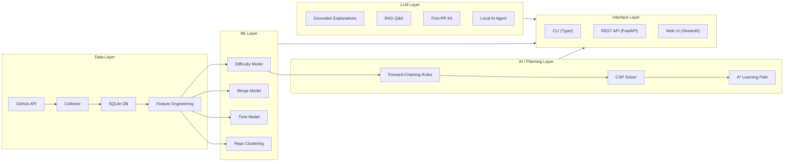

<p align="center">
  <h1 align="center">🔍 IssueScout</h1>
  <p align="center">
    <b>ML-powered GitHub issue recommender for open-source contributors</b><br>
    Find issues you can actually finish — with difficulty predictions, merge probabilities, and first-PR kits.
  </p>
  <p align="center">
    
    
    
    
    
  </p>
</p>

---

## What is IssueScout?

IssueScout is an intelligent recommendation system that helps open-source newcomers (especially GSoC and LFX applicants) find GitHub issues they can realistically solve. It combines:

- **ML difficulty prediction** (Easy / Medium / Hard) trained on 4,000+ merged PRs across 120+ repos
- **Merge probability estimation** so you pick issues likely to get merged
- **AI planning** (CSP + A\* search) to build an optimal work plan within your time budget
- **RAG-powered Q&A** over contributor docs (CONTRIBUTING.md, README, etc.)
- **First-PR kit generator** with step-by-step commands, CLA/DCO guidance, and draft PR text
- **Local AI agent** (zero API keys needed) for autonomous issue analysis

> **Philosophy:** ML predicts, rules and search decide, the LLM only explains. IssueScout never posts to GitHub on your behalf.

---

## Architecture



---

## Quick Start

### 1. Install

```bash
git clone https://github.com/YOUR_USERNAME/IssueScout.git
cd IssueScout
python -m venv .venv
# Windows: .venv\Scripts\activate  |  Linux/Mac: source .venv/bin/activate
pip install -r requirements.txt
```

### 2. Configure `.env`

```env
GITHUB_TOKEN=ghp_your_token_here
LLM_PROVIDER=ollama          # or: openai | anthropic | mock | none
LLM_MODEL=qwen2.5:0.5b
OLLAMA_BASE_URL=http://localhost:11434/v1
OPENAI_API_KEY=ollama         # only needed for openai provider
```

### 3. Collect Data & Train

```bash
python cli.py collect                    # pull repos + issues into SQLite
python cli.py features                   # build labels + features
python cli.py train all                  # train difficulty, merge, time models
python cli.py cluster                    # repo clustering + PCA
python cli.py evaluate                   # learning curves + kappa
python cli.py benchmark                  # CSP + A* benchmarks
python cli.py status                     # check: 16/16 targets?
```

Or run the whole pipeline at once:
```bash
bash scripts/run_all.sh
```

### 4. Use It

```bash
# Get a personalised issue plan
python cli.py recommend --skills python,docker --level beginner --hours 6 --weeks 3

# Predict difficulty of any issue
python cli.py predict kubernetes/kubernetes#12345

# First-PR kit with step-by-step commands
python cli.py prepare pallets/flask#5432

# Ask a repo's contributor docs
python cli.py ask pallets/flask "How do I run the tests?"

# Local AI agent (no API keys needed)
python cli.py solve-agent pallets/flask#5432

# Launch the web dashboard
python cli.py web
```

---

## CLI Reference

| Command | What it does |
|---------|-------------|
| `status` | Project health check — shows progress on all 16 targets |
| `collect` | Pull repos and issues from GitHub into SQLite (cached + resumable) |
| `add-repos` | Append extra repo lists to repos.txt (no duplicates) |
| `features` | Build labels, print class balance, export manual-labelling sample |
| `label` | Interactive manual labelling (auto label hidden to prevent bias) |
| `eda` | Exploratory data analysis → 10 figures + summary |
| `train` | Train difficulty / merge / time models (with optional tuning) |
| `cluster` | K-Means, DBSCAN, BIRCH clustering + anomaly detection + PCA |
| `evaluate` | Learning curves, kappa agreement, label sensitivity |
| `gd-demo` | Cost function + gradient descent + decision boundary demo |
| `predict` | Predict difficulty of ANY GitHub issue (live API lookup) |
| `benchmark` | CSP and A\* node-count benchmarks |
| `bayes-demo` | MLE vs Bayesian merge rate estimation |
| `recommend` | Ranked plan of issues within your time budget |
| `explain` | Show rules fired and CSP check for a plan item |
| `path` | A\* learning path to a harder target issue |
| `ask` | RAG Q&A over a repo's contributor docs |
| `prepare` | Build a first-PR kit for one issue |
| `solve-agent` | Local AI agent — analyzes issue and writes code fix |
| `eval-rag` | Evaluate RAG accuracy on test questions |
| `eval-llm` | LLM evaluation: JSON validity, agreement, guardrails |
| `outcome` | Log what happened with an issue you tried |
| `outcomes` | Summary of all logged outcomes |
| `report` | Collect all results into `report/RESULTS.md` |
| `serve` | Start the FastAPI backend on port 8000 |
| `web` | Launch the Streamlit dashboard |
| `test` | Run all 13 unit tests |

---

## ML Model Performance

### Difficulty Classification (Easy / Medium / Hard)

| Model | Test F1 (macro) | Grouped-CV F1 | ROC AUC | Train Time |
|-------|:---------:|:---------:|:-------:|:----------:|
| **LogReg (tuned)** ★ | **0.461** | **0.417** | 0.655 | 1.1s |
| RandomForest | 0.486 | 0.370 | 0.674 | 1.7s |
| MLP (64) | 0.461 | 0.394 | 0.629 | 41.3s |
| KNN (cosine) | 0.432 | 0.371 | 0.601 | 1.0s |
| GradientBoosting | 0.421 | 0.328 | 0.595 | 12.0s |
| SVM (linear) | 0.404 | 0.363 | 0.656 | 2.9s |
| DecisionTree | 0.376 | 0.267 | 0.543 | 1.1s |
| Majority baseline | 0.184 | — | — | — |

> ★ **Chosen model:** LogisticRegression (tuned, C=0.1) — best grouped-CV F1 on unseen repos.
> Trained on **3,991 issues** from **120 repos**. Label agreement κ = **0.719** (200 manual labels).

### Merge Prediction

| Model | CV AP (grouped) | Test AP | ROC AUC |
|-------|:---------:|:-------:|:-------:|
| RandomForest | 0.889 | 0.939 | 0.744 |
| LogReg | 0.884 | 0.940 | 0.755 |
| GradientBoosting | 0.876 | 0.940 | 0.741 |

### Time-to-Close Regression

> **Honest negative result:** No model beats the per-repo median baseline (R² < 0). Calendar close time is dominated by waiting, not effort. Best model: Ridge α=10 (R² = −0.72 test, +0.08 grouped-CV).

### RAG Evaluation

| Metric | Score |
|--------|:-----:|
| Accuracy | 72.7% |
| Retrieval Recall@4 | 100% |
| Mean Groundedness | 97.6% |
| Refusal Correctness | 100% |

---

## Project Structure

```
IssueScout/
├── cli.py                    # Typer CLI — the main entry point (22 commands)
├── .env                      # GitHub token + LLM config (git-ignored)
├── requirements.txt          # Core dependencies
├── requirements-rag.txt      # Full lockfile with RAG dependencies
│
├── collector/                # GitHub API → SQLite (cached & resumable)
│   ├── github_client.py      #   HTTP client with rate-limit + caching
│   ├── collect_repos.py      #   Fetch repo metadata
│   ├── collect_issues.py     #   Fetch issues, PRs, closed issues
│   ├── merge_repos.py        #   Merge repo lists (files or directories)
│   └── db.py                 #   SQLite schema + upsert helpers
│
├── features/                 # Feature engineering (leakage-free)
│   ├── labels.py             #   Effort-based difficulty labels (Easy/Med/Hard)
│   ├── build_features.py     #   Full feature matrix from DB
│   └── text_features.py      #   Structural text features (no PR data)
│
├── ml/                       # Machine learning models + evaluation
│   ├── train_difficulty.py   #   8 classifiers + temporal/grouped CV
│   ├── train_merge.py        #   Will-it-merge binary classification
│   ├── train_time.py         #   Time-to-close regression (Ridge, Lasso)
│   ├── cluster.py            #   K-Means, DBSCAN, BIRCH, PCA, anomaly
│   ├── evaluate.py           #   Learning curves, kappa, sensitivity
│   ├── predict.py            #   Live prediction for any issue URL
│   ├── gradient_descent_demo.py  #   Cost function + GD from scratch
│   ├── compare_labels.py     #   Label definition comparison
│   ├── common.py             #   Shared data loading + splits
│   ├── eda.py                #   10-figure EDA + summary
│   └── make_report.py        #   Compile RESULTS.md from all outputs
│
├── ai/                       # Classical AI techniques
│   ├── ontology.py           #   Skill knowledge graph (NetworkX)
│   ├── rules.py              #   Forward-chaining expert rules
│   ├── csp.py                #   CSP solver (backtrack + FC + MRV + bound)
│   ├── astar.py              #   A* learning path planner
│   ├── bayes.py              #   Bayesian merge rate estimation (MLE vs MAP)
│   ├── benchmark_csp.py      #   CSP node-count benchmark
│   └── benchmark_astar.py    #   A* vs uniform-cost benchmark
│
├── llm/                      # LLM integration
│   ├── client.py             #   Unified LLM client (OpenAI/Anthropic/Ollama/mock)
│   ├── explain.py            #   Grounded explanations (guardrail-checked)
│   ├── extract_skills.py     #   Skill extraction from issue text
│   ├── rag.py                #   RAG over contributor docs (TF-IDF + optional embeddings)
│   ├── first_pr_kit.py       #   First-PR kit (steps, commands, draft PR text)
│   ├── local_agent.py        #   Zero-dependency local AI agent (llama-cpp)
│   ├── eval_rag.py           #   RAG accuracy evaluation
│   └── eval_llm.py           #   LLM quality evaluation
│
├── core/                     # Business logic
│   ├── recommend.py          #   recommend() — the main recommendation engine
│   ├── profile.py            #   User profile (skills, level, hours, weeks)
│   └── outcomes.py           #   Outcome tracking (started → merged)
│
├── api/                      # REST API
│   └── main.py               #   FastAPI app (7 endpoints + /docs)
│
├── app/                      # Web dashboard
│   └── streamlit_app.py      #   8-tab Streamlit UI
│
├── tools/                    # Developer utilities
│   ├── label_cli.py          #   Interactive manual labelling
│   ├── check_questions.py    #   Validate RAG test questions
│   ├── show_docs.py          #   Browse cached contributor docs
│   └── diagnose_collection.py #  Debug data collection issues
│
├── tests/                    # Unit tests (13 tests)
│   ├── run_tests.py          #   Test runner (works without pytest)
│   ├── test_ai.py            #   CSP + A* tests
│   └── test_labels.py        #   Label + feature tests
│
├── repo_lists/               # Modular repository lists
│   ├── default.txt           #   Primary repos (~150)
│   ├── extra.txt             #   Extended repos (~90)
│   ├── gsoc_lfx.txt          #   GSoC/LFX target repos
│   └── ai_ml.txt             #   AI/ML ecosystem repos
│
├── scripts/
│   └── run_all.sh            #   Full pipeline runner (bash)
│
├── docs/
│   └── RESPONSIBLE_AI.md     #   PEAS table + responsible AI practices
│
├── data/                     # (git-ignored except processed/ and eval/)
│   ├── issuescout.db         #   SQLite database (all issues + repos)
│   ├── processed/            #   manual_label_sample.csv, repo_flags.csv
│   ├── eval/                 #   RAG test questions
│   ├── outcomes.jsonl        #   Your logged outcomes
│   └── feedback.jsonl        #   User feedback
│
├── models/                   # (git-ignored, re-train with `cli.py train`)
│   ├── difficulty.joblib     #   Difficulty classifier
│   ├── merge.joblib          #   Merge probability model
│   └── time.joblib           #   Time-to-close regressor
│
└── report/                   # All generated figures and results
    ├── RESULTS.md            #   Master results document
    ├── metrics.json          #   All metrics in one file
    ├── model_comparison.csv  #   Difficulty model comparison table
    ├── eda/                  #   10 EDA figures + summary.md
    └── *.png                 #   Confusion matrix, ROC, calibration, etc.
```

---

## Web Dashboard (Streamlit)

Launch with `python cli.py web` — 8 interactive tabs:

| Tab | Features |
|-----|----------|
| 🔍 Issue Recommender | Enter skills + budget → ranked plan with rules, CSP checks, explanations |
| 🤖 Local AI Agent | Paste any issue → autonomous analysis + code fix (no API keys) |
| ⚡ ML Training Terminal | One-click train/evaluate with real-time streaming output |
| 📂 Manage Repos | Add/remove repos, load from `repo_lists/` directory |
| 📊 Model Reports | All 10 ML figures with executive explanations |
| 🎯 Predict Any Issue | Difficulty prediction for any `owner/repo#123` URL |
| 💬 RAG Q&A | Ask any repo's contributor docs |
| 📈 Outcomes | Track your issue attempts → merged PRs |

---

## REST API (FastAPI)

Start with `python cli.py serve` → `http://localhost:8000/docs`

| Endpoint | Method | Description |
|----------|--------|-------------|
| `/health` | GET | Health check + model status |
| `/recommend` | POST | Get personalised issue recommendations |
| `/predict` | POST | Predict difficulty of any issue |
| `/prepare` | POST | Generate first-PR kit |
| `/ask` | POST | RAG Q&A on contributor docs |
| `/path` | POST | A\* learning path to a target issue |
| `/feedback` | POST | Submit user feedback |
| `/outcome` | POST | Log issue outcome |
| `/outcomes` | GET | Outcome summary |

---

## Responsible AI

IssueScout follows responsible AI practices documented in [`docs/RESPONSIBLE_AI.md`](docs/RESPONSIBLE_AI.md):

- **Read-only:** Never posts, comments, or opens anything on GitHub
- **Transparent:** Always shows probabilities, confidence flags, and rules fired
- **Leakage-free:** No PR-derived fields used as model inputs; temporal + unseen-repo evaluation
- **Honest:** Negative results kept and reported (time-to-close model)
- **Guardrailed:** LLM outputs fact-checked; invented numbers rejected; extractive RAG fallback
- **Rate-limited:** GitHub API responses cached; rate limits respected

---

## Tech Stack

| Layer | Technologies |
|-------|-------------|
| **Language** | Python 3.12+ |
| **ML** | scikit-learn, NumPy, pandas, SciPy, matplotlib, seaborn |
| **AI Planning** | NetworkX (knowledge graph), custom CSP/A\* solvers |
| **LLM** | OpenAI SDK, Anthropic SDK, Ollama, llama-cpp-python |
| **RAG** | TF-IDF (built-in), optional ChromaDB + sentence-transformers |
| **Web UI** | Streamlit 1.64 |
| **REST API** | FastAPI + Uvicorn |
| **CLI** | Typer + Rich |
| **Data** | SQLite, joblib, JSON/JSONL |
| **Testing** | pytest (13 tests) |

---

## License

This project was built as a university ML + AI course project. Feel free to use it for your own GSoC/LFX preparation.
