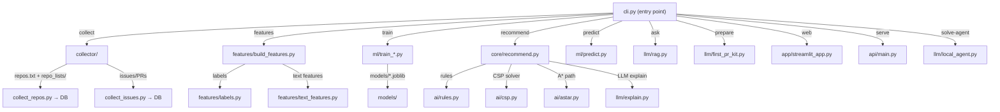

# IssueScout — Full Project Architecture & Code Improvement Guide

## How the Project Starts and Flows

---

## File-by-File Walkthrough

### Entry Points

#### [`cli.py`](file:///c:/Users/jaind/SEM%20V/ML/IssueScout/cli.py) (280 lines)
**What it does:** The main command-line interface. Every user interaction starts here.
- **Min capability:** Run `python cli.py --help` to see 22 available commands
- **Max capability:** Full pipeline execution, recommendation engine, predictions, AI agent, web/API launch
- **Key:** Uses Typer for CLI parsing, Rich for pretty tables

---

### Data Collection Layer (`collector/`)

#### [`collector/github_client.py`](file:///c:/Users/jaind/SEM%20V/ML/IssueScout/collector/github_client.py)
**What it does:** HTTP client for GitHub API with automatic rate-limit handling and disk caching.
- Every API response is MD5-hashed and cached to `data/raw/` as JSON
- Handles 403/404/429 errors gracefully
- **Improvement:** Add exponential backoff for 5xx errors; add request retry with `urllib3.Retry`

#### [`collector/collect_repos.py`](file:///c:/Users/jaind/SEM%20V/ML/IssueScout/collector/collect_repos.py)
**What it does:** Fetches repo metadata (stars, forks, language, topics) from GitHub API and stores in SQLite.
- Uses `load_repos()` from merge_repos to support both single files and `repo_lists/` directory
- **Improvement:** Add progress bar with `tqdm`; batch upserts for speed

#### [`collector/collect_issues.py`](file:///c:/Users/jaind/SEM%20V/ML/IssueScout/collector/collect_issues.py)
**What it does:** Fetches closed issues (with merged PRs = training data) and open issues (= recommendation candidates).
- Pagination support: `--closed-pages`, `--open-pages`, `--pr-pages`
- Extracts: title, body, labels, comments, creation date, close date, PR stats
- **Improvement:** Add `--since` date filter to collect only new issues (incremental)

#### [`collector/merge_repos.py`](file:///c:/Users/jaind/SEM%20V/ML/IssueScout/collector/merge_repos.py)
**What it does:** Merges repo lists from files or entire directories into `repos.txt` without duplicates.
- `load_repos(src)` — accepts a .txt file path OR a directory of .txt files
- **Improvement:** Add `--dry-run` flag to preview what would be added

#### [`collector/db.py`](file:///c:/Users/jaind/SEM%20V/ML/IssueScout/collector/db.py)
**What it does:** SQLite schema definition + upsert helpers.
- Creates `repos` and `issues` tables with proper indexing
- **Improvement:** Add migration system for schema changes; add `VACUUM` after large imports

---

### Feature Engineering (`features/`)

#### [`features/labels.py`](file:///c:/Users/jaind/SEM%20V/ML/IssueScout/features/labels.py)
**What it does:** Defines the difficulty label = effort of the resolving PR, relative to its own repository.
- `assign_labels(df, easy_q=0.4, hard_q=0.8)` — percentile-based thresholds
- Effort = `changed_files × 0.5 + additions × 1.0 + deletions × 0.3`
- **Leakage-free:** Only uses PR stats AFTER the PR is merged (training only)
- **Improvement:** Experiment with log-scaled effort; add `changed_files` weighting variants

#### [`features/build_features.py`](file:///c:/Users/jaind/SEM%20V/ML/IssueScout/features/build_features.py)
**What it does:** Builds the full feature matrix from SQLite.
- Joins repo metadata + issue text features + structural features
- Exports `data/processed/manual_label_sample.csv` for manual labelling
- **Improvement:** Add feature importance logging; cache feature matrix as parquet for speed

#### [`features/text_features.py`](file:///c:/Users/jaind/SEM%20V/ML/IssueScout/features/text_features.py)
**What it does:** Extracts structural text features from issue title + body at issue creation time.
- Features: `n_code_blocks`, `n_urls`, `n_paths`, `body_len`, `n_images`, `has_stacktrace`, etc.
- **Improvement:** Add sentiment score; add `n_questions` (count of `?`); extract mentioned file extensions

---

### Machine Learning (`ml/`)

#### [`ml/common.py`](file:///c:/Users/jaind/SEM%20V/ML/IssueScout/ml/common.py)
**What it does:** Shared data loading, temporal/grouped CV splits, metric calculation.
- `load_data()` → returns X, y, groups (repo names) DataFrames
- `temporal_split(df, ratio=0.8)` → oldest 80% train, newest 20% test
- `grouped_cv(X, y, groups, n_splits=5)` → GroupKFold by repo
- **Improvement:** Add stratified temporal split to preserve class balance

#### [`ml/eda.py`](file:///c:/Users/jaind/SEM%20V/ML/IssueScout/ml/eda.py)
**What it does:** 10-figure exploratory data analysis.
- Generates: class distribution, repo distribution, histograms, box plots, correlation matrix, text SVD, etc.
- Writes `report/eda/summary.md` with auto-generated observations
- **Improvement:** Add interactive Plotly versions; add missing value heatmap

#### [`ml/train_difficulty.py`](file:///c:/Users/jaind/SEM%20V/ML/IssueScout/ml/train_difficulty.py)
**What it does:** Trains 8 classifiers (LogReg, SVM, RF, GBM, KNN, MLP, DecisionTree, tuned LogReg).
- Temporal hold-out + grouped CV + bootstrap confidence intervals
- Saves: `models/difficulty.joblib`, confusion matrix, ROC curves, calibration plot
- Cost-sensitive metric: penalises "Hard called Easy" predictions
- **Improvement:** Add SHAP explanations for top features; try XGBoost/LightGBM

#### [`ml/train_merge.py`](file:///c:/Users/jaind/SEM%20V/ML/IssueScout/ml/train_merge.py)
**What it does:** Binary classifier — will this issue's PR get merged?
- Same evaluation framework as difficulty
- **Improvement:** Add calibration check; add feature importance plot

#### [`ml/train_time.py`](file:///c:/Users/jaind/SEM%20V/ML/IssueScout/ml/train_time.py)
**What it does:** Time-to-close regression. Compares Ridge, Lasso at multiple α values.
- **Honest negative result:** No model beats per-repo median (R² < 0)
- Saves regularisation effect plot showing L1 vs L2 coefficient norms
- **Improvement:** Frame as classification (fast/medium/slow) instead of regression

#### [`ml/cluster.py`](file:///c:/Users/jaind/SEM%20V/ML/IssueScout/ml/cluster.py)
**What it does:** Repo-level clustering + anomaly detection.
- K-Means (k chosen by silhouette), DBSCAN, BIRCH
- PCA + kernel PCA visualisation
- Isolation Forest anomaly detection
- **Improvement:** Add cluster naming heuristics based on centroid features

#### [`ml/evaluate.py`](file:///c:/Users/jaind/SEM%20V/ML/IssueScout/ml/evaluate.py)
**What it does:** Learning curves, manual-label kappa agreement, label sensitivity analysis.
- Plots train/val F1 vs training set size (bias-variance diagnosis)
- Cohen's kappa between your manual labels and auto labels
- **Improvement:** Add per-class learning curves; add permutation importance

#### [`ml/predict.py`](file:///c:/Users/jaind/SEM%20V/ML/IssueScout/ml/predict.py)
**What it does:** Predict difficulty of ANY GitHub issue (not just ones in your DB).
- `parse_ref("owner/repo#123")` or `parse_ref("https://github.com/...")` → (repo, number)
- Fetches issue from API if not in DB; builds features; runs model
- Returns: predicted class, confidence, probabilities, similar solved issues
- **Improvement:** Add caching of API predictions; add batch prediction mode

#### [`ml/gradient_descent_demo.py`](file:///c:/Users/jaind/SEM%20V/ML/IssueScout/ml/gradient_descent_demo.py)
**What it does:** From-scratch cost function + gradient descent + decision boundary.
- Implements logistic regression manually (no sklearn)
- Plots cost convergence curve + 2D decision boundary on PCA-reduced data

#### [`ml/compare_labels.py`](file:///c:/Users/jaind/SEM%20V/ML/IssueScout/ml/compare_labels.py)
**What it does:** Compares different label definitions to find which one models can learn best.

#### [`ml/make_report.py`](file:///c:/Users/jaind/SEM%20V/ML/IssueScout/ml/make_report.py)
**What it does:** Compiles `report/RESULTS.md` from all CSVs, metrics, and figures.

---

### Classical AI (`ai/`)

#### [`ai/ontology.py`](file:///c:/Users/jaind/SEM%20V/ML/IssueScout/ai/ontology.py)
**What it does:** Skill knowledge graph using NetworkX.
- Edge types: `REQUIRES`, `PART_OF`, `IMPLIES`
- `extract_keywords(text)` → finds skills mentioned in issue text
- `missing(known, needed)` → what skills you need to learn
- **Improvement:** Add more skill nodes (currently ~50); allow user-defined skill graphs

#### [`ai/rules.py`](file:///c:/Users/jaind/SEM%20V/ML/IssueScout/ai/rules.py)
**What it does:** Forward-chaining expert system rules for filtering issues.
- Rules: skill match, difficulty match, time budget check, repo activity check
- Each rule returns a fired/not-fired status with human-readable reason
- **Improvement:** Add configurable rule weights; allow user to disable specific rules

#### [`ai/csp.py`](file:///c:/Users/jaind/SEM%20V/ML/IssueScout/ai/csp.py)
**What it does:** Issue-selection CSP (Constraint Satisfaction Problem).
- Variables = k plan slots; domain = candidate issues
- Constraints: total hours ≤ budget, no same repo twice (configurable), skill coverage
- Algorithms: plain backtracking, +forward checking, +MRV, +bound pruning
- **Improvement:** Add diversity constraint (different languages/domains)

#### [`ai/astar.py`](file:///c:/Users/jaind/SEM%20V/ML/IssueScout/ai/astar.py)
**What it does:** A\* search for learning paths.
- State = set of skills known; action = finish a stepping-stone issue
- g = hours spent; h = (missing skills) × (cheapest hours-per-skill)
- Proves admissibility empirically
- **Improvement:** Add visualisation of the search tree

#### [`ai/bayes.py`](file:///c:/Users/jaind/SEM%20V/ML/IssueScout/ai/bayes.py)
**What it does:** Bayesian merge rate estimation using Beta-Binomial conjugacy.
- Compares MLE (raw merge rate) vs MAP (shrunk toward global prior)
- Shows how small repos benefit from Bayesian shrinkage

#### [`ai/benchmark_csp.py`](file:///c:/Users/jaind/SEM%20V/ML/IssueScout/ai/benchmark_csp.py) + [`ai/benchmark_astar.py`](file:///c:/Users/jaind/SEM%20V/ML/IssueScout/ai/benchmark_astar.py)
**What they do:** Node-count benchmarks comparing algorithm variants. Write markdown reports.

---

### LLM Integration (`llm/`)

#### [`llm/client.py`](file:///c:/Users/jaind/SEM%20V/ML/IssueScout/llm/client.py)
**What it does:** Unified LLM client supporting 5 providers.
- Providers: `openai`, `anthropic`, `ollama`, `mock`, `none`
- `complete(system, user, …)` → returns text or None (never crashes)
- `ping()` → tests connection, returns (ok, message, seconds)
- Errors logged to `data/llm_errors.log`
- **Improvement:** Add streaming support; add token usage tracking; add provider failover chain

#### [`llm/explain.py`](file:///c:/Users/jaind/SEM%20V/ML/IssueScout/llm/explain.py)
**What it does:** Grounded explanations — LLM restates model outputs in natural language.
- Post-check rejects invented numbers
- Falls back to template if LLM fails
- **Improvement:** Add confidence-aware explanation templates

#### [`llm/extract_skills.py`](file:///c:/Users/jaind/SEM%20V/ML/IssueScout/llm/extract_skills.py)
**What it does:** Extracts skill tags from issue text using ontology + optional LLM.

#### [`llm/rag.py`](file:///c:/Users/jaind/SEM%20V/ML/IssueScout/llm/rag.py)
**What it does:** RAG over contributor docs (CONTRIBUTING.md, README, dev guides).
- Retrieval backends: TF-IDF (built-in, always works) + optional ChromaDB embeddings
- `fetch_docs(repo)` → crawls GitHub for contributor docs, caches to `data/docs/`
- `ask(repo, question)` → retrieves + optionally LLM-generates answer
- Groundedness scoring on every answer
- **Improvement:** Add chunking strategy options; add citation highlighting

#### [`llm/first_pr_kit.py`](file:///c:/Users/jaind/SEM%20V/ML/IssueScout/llm/first_pr_kit.py)
**What it does:** Generates a complete first-PR kit for any issue.
- Step-by-step commands, CLA/DCO guidance, draft commit message, draft PR body
- Outputs as markdown + saves to `data/kits/`
- **Improvement:** Add template per language/ecosystem (Python vs Go vs Rust)

#### [`llm/local_agent.py`](file:///c:/Users/jaind/SEM%20V/ML/IssueScout/llm/local_agent.py)
**What it does:** Zero-dependency embedded AI agent using llama-cpp-python.
- Runs `qwen2.5-coder-0.5b.Q4_K_M.gguf` locally (no API keys)
- Extracts stack traces, smart-chunks long descriptions
- Outputs structured GitHub-ready PR markdown with diffs
- **Improvement:** Add multi-turn conversation; add file-aware context (read actual repo code)

#### [`llm/eval_rag.py`](file:///c:/Users/jaind/SEM%20V/ML/IssueScout/llm/eval_rag.py) + [`llm/eval_llm.py`](file:///c:/Users/jaind/SEM%20V/ML/IssueScout/llm/eval_llm.py)
**What they do:** Evaluation frameworks for RAG accuracy and LLM quality.

---

### Core Business Logic (`core/`)

#### [`core/recommend.py`](file:///c:/Users/jaind/SEM%20V/ML/IssueScout/core/recommend.py)
**What it does:** The main recommendation engine — the heart of IssueScout.
- `recommend(profile)` → ranked plan of issues within budget
- Pipeline: load scored issues → filter by rules → solve CSP → rank by merge prob × difficulty match → explain
- `learning_path(profile, target)` → A\* path to a harder target issue
- **Improvement:** Add diversity scoring; add "explain why NOT" for rejected issues

#### [`core/profile.py`](file:///c:/Users/jaind/SEM%20V/ML/IssueScout/core/profile.py)
**What it does:** User profile model (Pydantic).
- Fields: skills, level, hours_per_week, weeks, k (plan size), avoid list, use_llm flag

#### [`core/outcomes.py`](file:///c:/Users/jaind/SEM%20V/ML/IssueScout/core/outcomes.py)
**What it does:** Tracks what happened with recommended issues (started → merged).
- Appends to `data/outcomes.jsonl`
- `summary()` → counts by status

---

### Interface Layer

#### [`api/main.py`](file:///c:/Users/jaind/SEM%20V/ML/IssueScout/api/main.py) (93 lines)
**What it does:** FastAPI REST API with 9 endpoints.
- `/recommend`, `/predict`, `/prepare`, `/ask`, `/path`, `/feedback`, `/outcome`, `/outcomes`, `/health`
- Auto-docs at `/docs` (Swagger UI)
- **Improvement:** Add authentication; add request validation; add response caching

#### [`app/streamlit_app.py`](file:///c:/Users/jaind/SEM%20V/ML/IssueScout/app/streamlit_app.py)
**What it does:** 8-tab Streamlit dashboard.
- Tabs: Issue Recommender, Local AI Agent, ML Training Terminal, Manage Repos, Model Reports, Predict Any Issue, RAG Q&A, Outcomes
- Responsive metric cards, executive explanations under every ML plot
- Real-time streaming output for training commands
- **Improvement:** Add dark/light theme toggle; add export-to-PDF; add session persistence

---

### Utilities (`tools/`, `scripts/`, `tests/`)

#### [`tools/label_cli.py`](file:///c:/Users/jaind/SEM%20V/ML/IssueScout/tools/label_cli.py)
**What it does:** Interactive manual labelling UI. Auto-label is HIDDEN to prevent bias.

#### [`tools/check_questions.py`](file:///c:/Users/jaind/SEM%20V/ML/IssueScout/tools/check_questions.py)
**What it does:** Validates RAG test questions before running eval-rag.

#### [`tools/diagnose_collection.py`](file:///c:/Users/jaind/SEM%20V/ML/IssueScout/tools/diagnose_collection.py)
**What it does:** Debugs data collection — shows rate limits, missing repos, empty repos.

#### [`scripts/run_all.sh`](file:///c:/Users/jaind/SEM%20V/ML/IssueScout/scripts/run_all.sh)
**What it does:** Full pipeline runner (bash). Runs all commands in order.

#### Tests (13 tests total)
- `test_ai.py` — CSP solver + A\* search correctness
- `test_labels.py` — Label assignment + text feature extraction

---

## Libraries & Frameworks Used

| Library | Purpose | Used In |
|---------|---------|---------|
| **scikit-learn** | All ML models, CV, metrics, PCA | `ml/` |
| **pandas** | DataFrames, CSV I/O | everywhere |
| **numpy** | Numerical ops | everywhere |
| **scipy** | Beta distribution (Bayes) | `ai/bayes.py` |
| **matplotlib + seaborn** | All static plots | `ml/eda.py`, `ml/train_*.py` |
| **NetworkX** | Skill knowledge graph | `ai/ontology.py` |
| **joblib** | Model serialisation | `ml/train_*.py`, `ml/predict.py` |
| **Typer + Rich** | CLI framework | `cli.py` |
| **FastAPI + Uvicorn** | REST API | `api/main.py` |
| **Streamlit** | Web dashboard | `app/streamlit_app.py` |
| **Pydantic** | Data validation | `core/profile.py`, `api/main.py` |
| **OpenAI SDK** | GPT / Ollama client | `llm/client.py` |
| **Anthropic SDK** | Claude client | `llm/client.py` |
| **llama-cpp-python** | Local GGUF inference | `llm/local_agent.py` |
| **requests** | GitHub API | `collector/github_client.py` |
| **python-dotenv** | .env loading | everywhere |
| **pytest** | Test framework | `tests/` |

---

## Top 10 Code Improvements (Priority Order)

| # | Improvement | File(s) | Impact |
|---|-----------|---------|--------|
| 1 | **Add SHAP explanations** for model predictions | `ml/train_difficulty.py`, `ml/predict.py` | Makes predictions interpretable for reports |
| 2 | **Add progress bars** (tqdm) to collection & training | `collector/`, `ml/train_*.py` | Better UX during long operations |
| 3 | **Add streaming LLM support** | `llm/client.py` | Responsive AI agent and explanations |
| 4 | **Add provider failover chain** (ollama → mock) | `llm/client.py` | Resilience when LLM is down |
| 5 | **Cache feature matrix as parquet** | `features/build_features.py` | 10x faster repeated training |
| 6 | **Add incremental collection** (`--since` flag) | `collector/collect_issues.py` | Don't re-fetch old issues |
| 7 | **Add batch prediction mode** | `ml/predict.py` | Predict many issues at once |
| 8 | **Add authentication to API** | `api/main.py` | Production-ready REST API |
| 9 | **Add per-class learning curves** | `ml/evaluate.py` | Better bias-variance analysis |
| 10 | **Add multi-turn local agent** | `llm/local_agent.py` | Conversational issue debugging |

---

## Figma Design Prompt

Use this prompt when creating a Figma mockup for the IssueScout web dashboard:

> **Design a modern, responsive web dashboard for "IssueScout" — an ML-powered GitHub issue recommender for open-source contributors. The app has 8 main sections accessible via a sidebar or top navigation:**
>
> 1. **Issue Recommender** (hero page): A form with inputs for Skills (multi-select chips: python, go, docker, etc.), Experience Level (beginner/intermediate/advanced), Weekly Hours (slider), and Weeks Available (slider). Below, a ranked card-based plan showing each recommended issue with: repo name, issue number, difficulty badge (Easy=green, Medium=amber, Hard=red), merge probability %, estimated hours, and skill tags. Each card expands to show rules fired, CSP check, and AI explanation.
>
> 2. **AI Agent**: A chat-like interface where you paste a GitHub issue URL and get an autonomous analysis with code diffs in a dark-themed code block.
>
> 3. **ML Training Terminal**: A dark terminal window with streaming output. Buttons: "Train All", "Train Difficulty", "Evaluate", "Run EDA". A progress ring shows current step.
>
> 4. **Manage Repos**: Two panels — left shows current repo list with checkboxes and delete buttons; right has an "Add Repos" area with a text input and a drag-and-drop zone for .txt files. Tags for repo categories (GSoC, AI/ML, Web).
>
> 5. **Model Reports**: A grid of ML figure cards (confusion matrix, ROC, calibration, learning curves, etc.). Each card has the chart + a 2-line executive summary underneath. A comparison table below with colour-coded F1 scores.
>
> 6. **Predict Any Issue**: Single input field for `owner/repo#123`, a large "Predict" button, and result cards showing predicted difficulty, confidence gauge, probability bars, and similar solved issues.
>
> 7. **RAG Q&A**: Chat interface — type a repo name and question, get an answer with source citations and a groundedness score badge.
>
> 8. **Outcomes Tracker**: A Kanban board with columns: Started → PR Opened → Merged → Abandoned. Cards show issue title, hours logged, and date.
>
> **Style:** Clean, minimal, dark sidebar with icons, white/light-gray content area, rounded cards with subtle shadows, accent color #FF6B6B (coral), secondary #4ECDC4 (teal). Use Inter or DM Sans font. Include a small "IssueScout" logo (magnifying glass + code brackets) in the top-left.
>
> **Dimensions:** Design for 1440×900 desktop first, then responsive breakpoints for tablet (768px) and mobile (375px).
